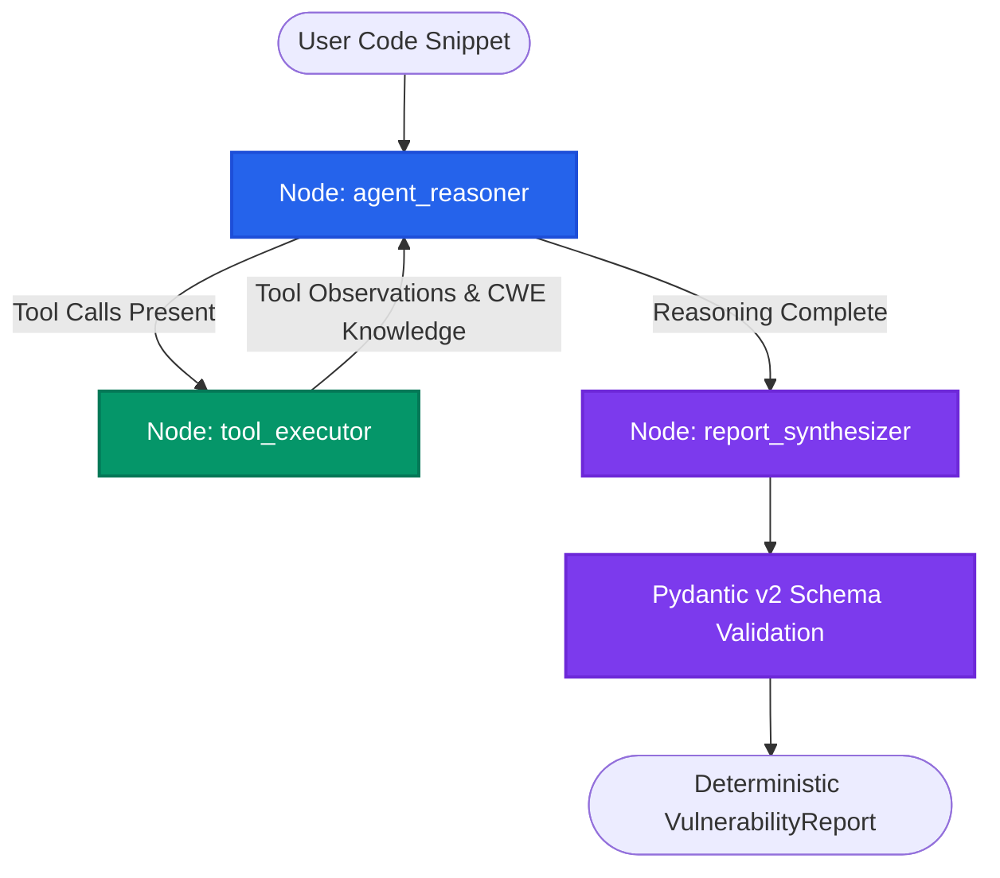

#  SentinelGraph: Autonomous Stateful Security Auditor

An intelligent, stateful security auditing agent built with **LangGraph, LangChain, Pydantic v2, and Open-Source LLMs** (via Groq / OpenAI).

Unlike traditional linear tool-calling pipelines, SentinelGraph implements a **cyclic ReAct (Reason + Act) architecture** to autonomously inspect source code, execute deterministic AST-based security heuristics, retrieve CWE knowledge, and iteratively investigate potential vulnerabilities.

The system produces structured, schema-validated security reports using Pydantic contracts, making its output suitable for automated security analysis workflows.

---

##  System Architecture

SentinelGraph operates as a cyclic directed state graph. The agent reasons over the provided source code, selectively invokes security tools, evaluates their observations, and iterates until the investigation is complete.



### Core Execution Flow

1. **Agent Reasoner:** Analyzes the submitted source code and determines whether additional investigation is required.
2. **Tool Executor:** Executes deterministic static-analysis tools and retrieves relevant CWE security knowledge.
3. **Iterative Investigation:** Returns tool observations to the reasoning agent for further analysis.
4. **Report Synthesizer:** Consolidates the investigation into a structured vulnerability report.
5. **Schema Validation:** Validates the final output against the Pydantic v2 contract.

---

##  Key Features

- **Stateful Cyclic Graph Architecture:** Uses LangGraph's `StateGraph` to implement an autonomous ReAct loop instead of a simple linear execution pipeline.
- **Deterministic Static Analysis:** Combines AST-based heuristics with LLM reasoning to investigate potential security weaknesses.
- **CWE Knowledge Integration:** Maps identified vulnerabilities to relevant Common Weakness Enumeration (CWE) references.
- **Type-Safe Tool Contracts:** Uses Pydantic schemas such as `StaticAnalysisInput` to enforce structured tool arguments and reduce invalid tool calls.
- **Defensive Output Serialization:** Combines `PydanticOutputParser` with regex-tolerant fallback parsing to handle inconsistent LLM output formats.
- **False-Positive Awareness:** Distinguishes potentially exploitable vulnerabilities, such as SQL injection and remote code execution, from general security hygiene concerns.
- **Structured Security Reports:** Enforces a consistent JSON-compatible output format through Pydantic validation.

---

##  Technology Stack

| Component | Technology |
|---|---|
| Agent Orchestration | LangGraph |
| LLM Framework | LangChain Core |
| Inference Engine | Groq / OpenAI API |
| Language Models | LLaMA-3 / GPT-OSS |
| Schema Validation | Pydantic v2 |
| Static Analysis | Python AST-based heuristics |
| CWE Mapping | CWE Knowledge Base |
| CLI Interface | Rich |
| Programming Language | Python |

---

##  Installation & Quickstart

### Option 1: Google Colab

1. Upload `SentinelGraph_Auditor.ipynb` to Google Colab.
2. Install the required dependencies:

```bash
pip install -q -U langgraph langchain langchain-core langchain-groq pydantic rich
```

3. Configure your Groq API key:

```python
import os

os.environ["GROQ_API_KEY"] = "your_groq_api_key"
```

4. Execute all notebook cells to initialize and run the security auditor.

### Option 2: Local Installation

**1. Clone the repository**

```bash
https://github.com/mariaaktermukti/SentinelGraph-Autonomous-Stateful-Security-Auditor-using-LangGraph-and-Pydantic
```

**2. Create a virtual environment**

```bash
python -m venv venv
```

**3. Activate the environment**

Windows (PowerShell):

```powershell
.\venv\Scripts\Activate.ps1
```

Linux / macOS:

```bash
source venv/bin/activate
```

**4. Install dependencies**

```bash
pip install langgraph langchain langchain-core langchain-groq pydantic rich
```

**5. Configure environment variables**

Set your Groq API key:

PowerShell:

```powershell
$env:GROQ_API_KEY="your_groq_api_key"
```

Linux / macOS:

```bash
export GROQ_API_KEY="your_groq_api_key"
```

**6. Run the auditor**

```bash
python agent_pipeline.py
```

---

##  Security Evaluation & Benchmark Cases

SentinelGraph is evaluated using different source-code scenarios to assess vulnerability detection and false-positive handling.

### Case 1: SQL Injection Vulnerability

**Input:**

```python
def get_user_profile(user_input):
    query = f"SELECT id, username, email FROM accounts WHERE username = '{user_input}'"
    cursor.execute(query)
    return cursor.fetchall()
```

**Expected Audit Result:**

| Attribute | Result |
|---|---|
| Status | VULNERABLE |
| Risk Severity | HIGH |
| Vulnerability | SQL Injection |
| CWE Reference | CWE-89 |

**Identified Issue:**

The SQL query directly embeds untrusted user input through an f-string, allowing an attacker to manipulate the SQL statement.

**Suggested Remediation:**

Replace string interpolation with parameterized SQL queries.

```python
query = "SELECT id, username, email FROM accounts WHERE username = %s"
cursor.execute(query, (user_input,))
```

### Case 2: Secure Parameterized Query

**Input:**

```python
def get_user_profile(user_input):
    query = "SELECT id, username, email FROM accounts WHERE username = %s"
    cursor.execute(query, (user_input,))
    return cursor.fetchall()
```

**Expected Audit Result:**

| Attribute | Result |
|---|---|
| Status | CLEAN |
| Risk Severity | CLEAN |
| Vulnerability | None |
| CWE Reference | None |

**Analysis:**

The agent recognizes the parameterized SQL query and does not incorrectly classify the absence of additional input validation as an exploitable SQL injection vulnerability.

This case evaluates the system's ability to avoid unnecessary security findings.

---

##  Pydantic Output Schema

Every security audit report follows a predefined Pydantic v2 schema.

```python
from pydantic import BaseModel, Field
from typing import Literal, Optional

class VulnerabilityReport(BaseModel):
    is_safe: bool = Field(
        ...,
        description="True if safe, False if vulnerabilities detected."
    )

    risk_level: Literal[
        "CRITICAL", "HIGH", "MEDIUM", "LOW", "CLEAN"
    ]

    vulnerability_type: Optional[str]
    affected_construct: Optional[str]
    cwe_reference: Optional[str]

    technical_explanation: str
    remediation_patch: Optional[str]
```

### Output Fields

| Field | Description |
|---|---|
| `is_safe` | Indicates whether vulnerabilities were detected. |
| `risk_level` | Assigned security severity. |
| `vulnerability_type` | Identified vulnerability category. |
| `affected_construct` | Source-code construct associated with the finding. |
| `cwe_reference` | Relevant CWE identifier. |
| `technical_explanation` | Technical reasoning behind the finding. |
| `remediation_patch` | Suggested secure implementation. |

---


##  Future Improvements

- Expand vulnerability detection across additional CWE categories.
- Integrate more advanced AST-based static analysis.
- Add support for multiple programming languages.
- Introduce severity scoring and confidence estimation.
- Integrate automated security testing and regression benchmarks.
- Support CI/CD pipeline integration for continuous security auditing.

---


This project is distributed under the **MIT License**. See the [LICENSE](LICENSE) file for details.

---

**SentinelGraph — Reason. Investigate. Secure.**
